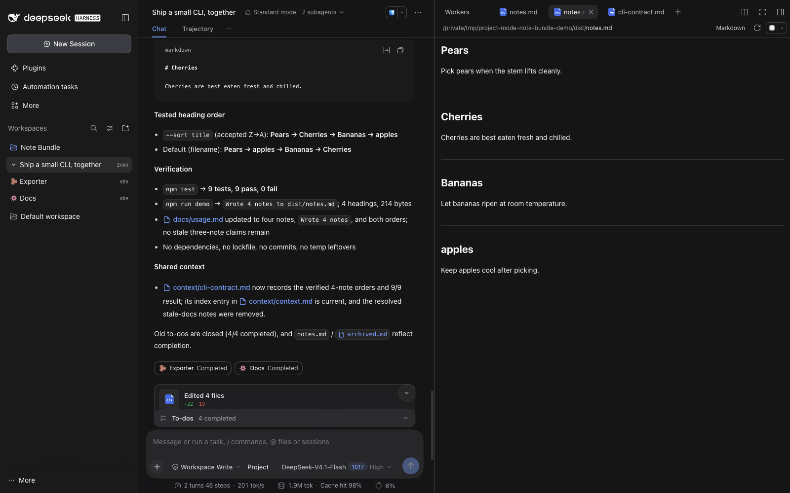
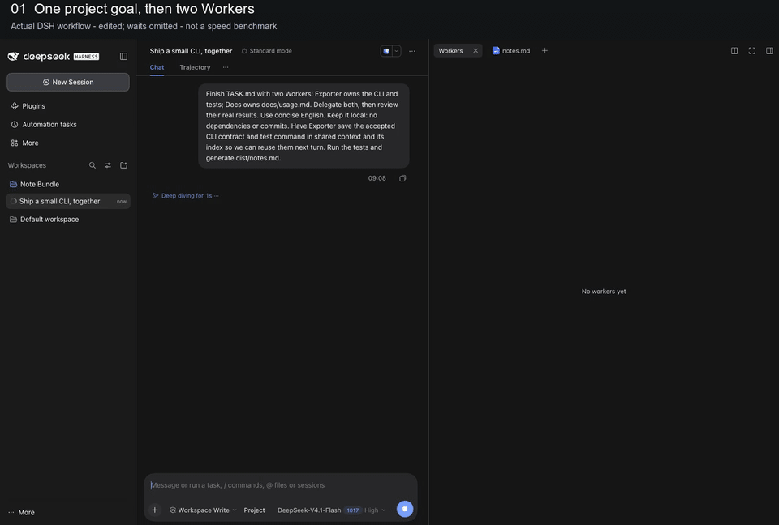
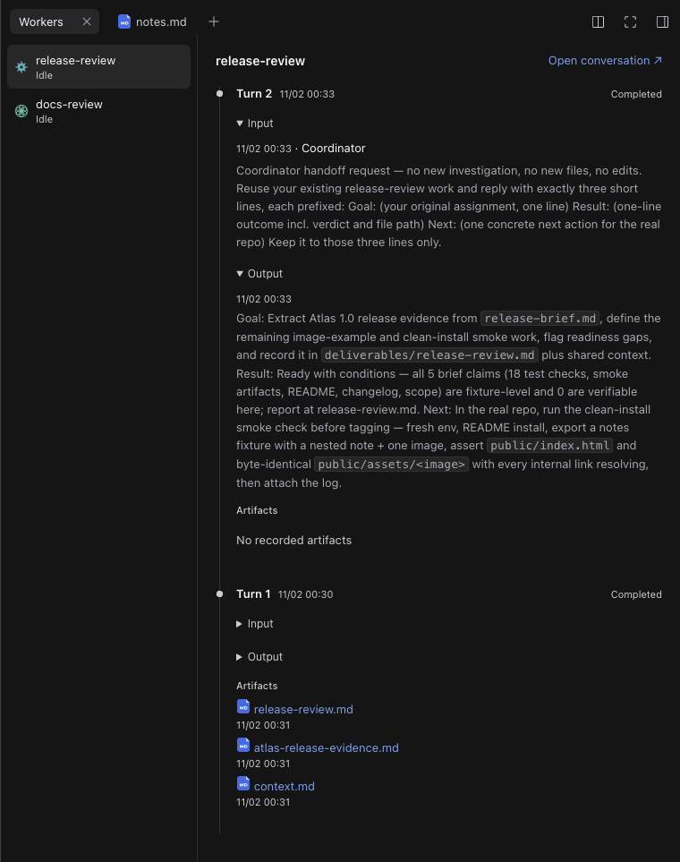
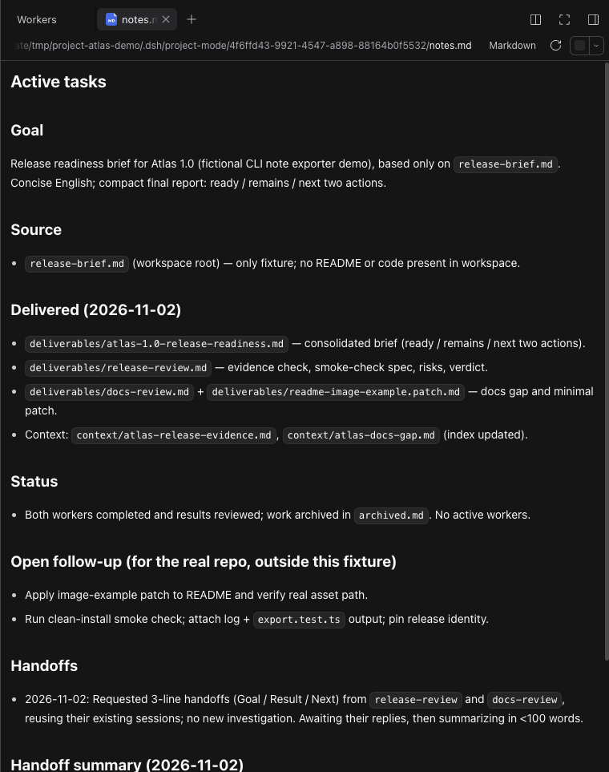

# MoA+

**Advancing intelligence through multi-agent collaboration.** MoA+ aims to build a Mixture of Agents system, exploring how agents working together can take the capabilities of the whole system to the next level.

English | [简体中文](README.zh.md)

[](docs/media/project-workflow.mp4)

The current preview runs as an unofficial DeepSeek Harness plugin, with a Coordinator, persistent Worker conversations, shared context and result review. These are the starting point for the system's development.

[Watch the 60-second workflow](docs/media/project-workflow.mp4) · [Explore the screenshots](#see-it-in-action) · [Install](#quick-start)

**Unofficial source preview. Latest published tag: v0.1.23.** Requires DSH **0.2.1-rc.3 with the three compatibility extensions documented in this repository**. The isolated setup below prepares these extensions for you; stock rc.3 cannot enable the plugin directly. See [Compatibility](docs/compatibility.md).

MoA+ was previously named Project Mode. The v0.1.23 runtime and demos still use the **Project** label; the original package identity remains compatible.

## Contents

- [Current implementation](#current-implementation)
- [See it in action](#see-it-in-action)
- [Quick start](#quick-start)
- [User guide](#user-guide)
- [Shared context](#shared-context)
- [Features in DSH](#features-in-dsh)
- [Code structure](#code-structure)
- [Development](#development)
- [API and documentation](#api-and-documentation)
- [Current limits](#current-limits)
- [License](#license)

## Current implementation

In the current implementation, you describe a goal to the Coordinator. It creates or reuses Workers, guides their work, reviews results and maintains shared context. The sections below describe the capabilities available today; further collaboration mechanisms will evolve through design and validation.

| Capability                 | What it gives you                                                                                                       |
| -------------------------- | ----------------------------------------------------------------------------------------------------------------------- |
| Persistent coordination    | One Coordinator conversation owns the project's work records and next steps.                                            |
| Full Worker control        | Create or reuse Workers, steer current work, queue later instructions, inspect status and history, interrupt or delete. |
| Shared project knowledge   | Coordinator and Workers maintain an index and load relevant context progressively.                                      |
| Automatic result return    | Each ended Worker turn returns its full final AI message for Coordinator review.                                        |
| Direct human participation | Open a Worker, guide it yourself, then return to the Coordinator.                                                       |
| Native DSH execution       | Sessions, Agent Loop, tools, permissions, message delivery and Stop stay with DSH.                                      |

## See it in action

A small CLI change makes the handoffs visible: Exporter implements title sorting and tests, Docs maintains the usage guide, and the Coordinator reviews their results. A human changes the ordering inside Exporter's conversation; a later task adds another note using the accepted contract.

[](docs/media/project-workflow.mp4)

The edited recording shows a real CLI task: **dispatch Workers → human changes title sorting inside Exporter → Coordinator catches up → next turn reuses the same Workers and shared context**. Waiting is cut and labeled throughout; it is not a 60-second completion claim. The finished sample passed 9 real tests. [Try the task](docs/demo-workflow.md) or [inspect its actual result](docs/demo-result). [Open the MP4](docs/media/project-workflow.mp4) for playback controls, or [view the workspace screenshot](docs/media/project-workspace.png) at full size.
[](docs/media/workflow-result.png)

### Follow each Worker's work

Choose a Worker to see its turns from newest to oldest. Expand the original instruction and final AI response when you need the detail; open recorded artifacts or jump into the conversation to guide it yourself.

[](docs/media/worker-timeline.png)

### Keep the project ready for the next task

`notes.md` stays beside the conversation: goal, delivered work, current status and next steps. The Coordinator maintains it while reusable knowledge accumulates under the shared context index.

[](docs/media/project-notes.png)

The workflow video uses the v0.1.23 isolated runtime and the public Note Bundle fixture. The earlier detail screenshots show the fictional **Project Atlas** workspace on v0.1.22. These are real DSH captures, not product mockups or speed benchmarks. [Capture details and reuse](docs/media/README.md).

## Quick start

Try the current source preview from `main` in a separate **compatible DSH Web environment**. Requires Node **24.9+**, npm and Git:

```sh
git clone https://github.com/Burns1028/moa-plus.git
cd moa-plus
node scripts/moa.mjs setup
node scripts/moa.mjs start
```

Setup installs the locked rc.3 runtime and applies exactly the three reviewed extensions inside `~/.dsh-project-mode/rc3`. Your ordinary Desktop app, `~/.dsh`, global Agent configuration and workspaces are not reused. The native Web UI opens locally; configure your model, create a conversation and select **MoA** before its first message.

An already prepared runtime is reused. To try changed source, use a fresh empty directory with `--dir` on both setup and start, even when the plugin version is unchanged; see the first-run guide below.

Use `node scripts/moa.mjs doctor` to check the prepared environment. See the [first-run guide](docs/quickstart.md) for locations, restart and recovery, and try the [reproducible project task](docs/demo-workflow.md).

For an already prepared compatible Desktop/runtime, the plugin can still be installed through its native CLI:

```sh
dsh plugin --profile desktop add "git+https://github.com/Burns1028/moa-plus.git#v0.1.23"
```

The pinned v0.1.23 release uses the previous Project label and `scripts/project-mode.mjs` entry. Stock rc.3 remains incompatible. The setup script is explicit, not an npm installation hook, and does not patch an existing Desktop app. [Compatibility](docs/compatibility.md) documents the three native extensions and manual route; tagged bundles are on [Releases](https://github.com/Burns1028/moa-plus/releases).

## User guide

| Role        | Responsibility                                                                                                                                                                                                  |
| ----------- | --------------------------------------------------------------------------------------------------------------------------------------------------------------------------------------------------------------- |
| You         | Set goals, make decisions and talk to the Coordinator. You can also open a Worker and guide it directly.                                                                                                        |
| Coordinator | Choose and guide Workers, supply context, review results, maintain work records, organize shared knowledge and report progress. It can handle clarification, synthesis and small self-contained actions itself. |
| Worker      | Carry an assigned investigation or execution through to a result, contribute reusable findings and return a self-contained final AI message.                                                                    |

A usual workflow:

1. You bring a goal to the Coordinator. It checks Workers and relevant project memory, including direct user activity in child conversations.
2. It chooses an existing Worker or creates one, supplies the goal and context, then updates `notes.md`.
3. As work changes, it uses **steer** to guide the current work or **queue** to leave an instruction for after the current turn. Interrupt and delete remain separate actions.
4. Each Worker turn automatically returns its complete last committed AI message. A turn without an AI message still reports its identity and outcome with an empty AI result.
5. The Coordinator reviews the result, follows up or concludes, and updates work records and reusable context. Normal closure waits for relevant work and result consumption within the same native Coordinator turn.

When you operate a Worker directly, the Coordinator can inspect its current state and read the conversation as needed when you return.

## Shared context

```text
.dsh/project-mode/<project-id>/
├── notes.md                 Todos, assignments, progress, blockers, next steps
├── archived.md              Concluded work and its results
└── context/
    ├── context.md           Shared index: file paths and short descriptions
    ├── decisions.md         Reusable decisions and their reasons, created as needed
    └── ...                  Other reusable project knowledge
```

In the current implementation, the Coordinator maintains `notes.md` and `archived.md` so it knows where the project stands and what needs attention.

Both the Coordinator and Workers maintain context. They read `context/context.md` first, then open the files needed for the current task. Workers contribute valuable reusable findings and update the index. The Coordinator primarily organizes, consolidates and prunes that knowledge. Routine progress stays in the work records.

These documents persist with the project; they are loaded progressively rather than copied into every request. See [goals and current role responsibilities](docs/moa-architecture.md) for more detail.

## Features in DSH

- Select **MoA** for a new conversation before its first message. The session keeps MoA enabled after its first turn starts.
- Expand the Coordinator in the original workspace sidebar to open its Workers. Each has a stable identity icon and current status.
- Click a Worker capsule in the main conversation to open that child. Capsules stay with the conversation segment where work was dispatched, updated or received; later passive replies do not move them.
- Use the default **Workers** and **notes.md** tabs on the right. Workers shows a newest-first timeline of original input, final AI output and recorded artifacts. Each message shows up to two lines of text with an ellipsis for overflow; click the message to expand its original Markdown or collapse it. Both tabs are closable.
- Worker composers provide **Back** to the Coordinator and use native delegated permissions without an independent permission picker. Archiving the Coordinator brings its managed Workers along.

Coordinator delegation/control tools are replaced only in that Agent's scope. Workers and ordinary conversations retain native composition. Native Stop remains available and does not automatically stop every Worker.

## Code structure

```text
packages/moa/
├── src/host/       MoA lifecycle, Worker operations and result delivery
├── src/client/     Sidebar, capsules and project tabs
├── src/shared/     Shared types and contracts
└── lib/            Built plugin artifacts
compat/rc3/         Audited runtime compatibility patches
scripts/            Build, compatibility and verification helpers
tests/              Regression and native contract checks
docs/               Model, architecture, API and verification guides
```

## Development

Requires Node **24.9+**, npm and Git.

```sh
git clone https://github.com/Burns1028/moa-plus.git
cd moa-plus
npm ci
node scripts/apply-native-compat.mjs --dry-run
node scripts/apply-native-compat.mjs --backup "$PWD/.superpowers/native-backup"
npm test -- --maxWorkers=1
```

`npm test` builds the plugin first. Edit `packages/moa/src`; regenerate the committed `lib` artifacts through the build. See [Contributing](CONTRIBUTING.md) for typechecks, native contracts, package consumer verification and the test map.

## API and documentation

The Coordinator uses `control_workers` with `spawn`, `list`, `get`, `send`, `history`, `interrupt` and `delete`. `send` distinguishes current-work **steer** from next-turn **queue**. See the tool API for arguments, examples and result semantics.

| Read this | To understand |
| --- | --- |
| [Goals and current roles](docs/moa-architecture.md) | System goal, current role responsibilities and progressive shared context |
| [Code architecture](docs/architecture.md) | Modules, functions, data structures and execution paths |
| [Tool API](docs/tool-api.md) | Worker control, message delivery and history windows |
| [Compatibility](docs/compatibility.md) | The explicit rc.3 runtime extensions |
| [Verification](docs/verification.md) / [Manual checks](docs/manual-verification.md) | What was tested and how to check a real application |

## Current limits

Delegation remains a model judgment. This preview does not guarantee ideal task ownership on every request, and does not use task keywords or command/time thresholds to force it.

Try MoA+ on a small project and share your workflow or installation feedback in [trial feedback](https://github.com/Burns1028/moa-plus/issues/new?template=project-mode-trial.yml). If you would like to follow its development, a star helps others discover it.

## License

MIT. See [LICENSE](LICENSE) and [third-party notices](THIRD_PARTY_NOTICES.md).
