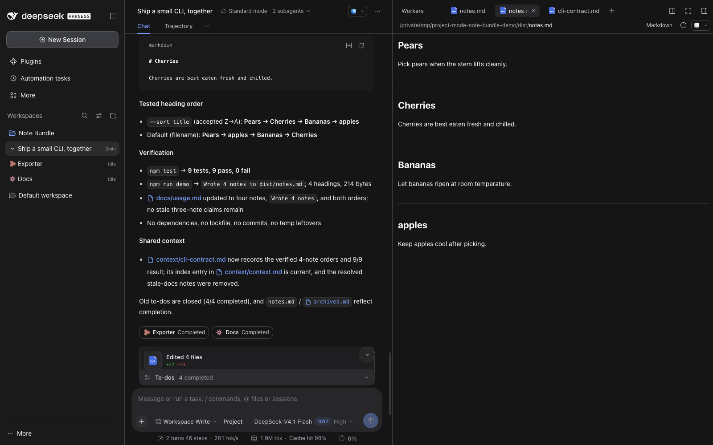
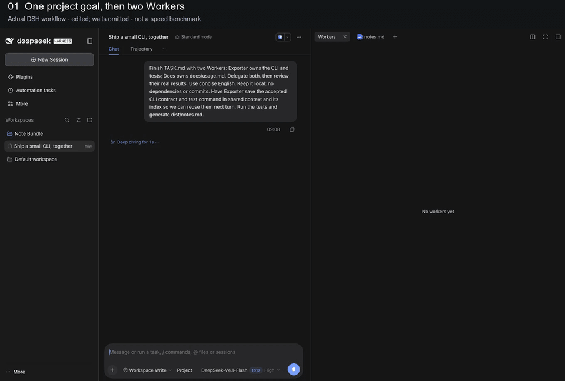
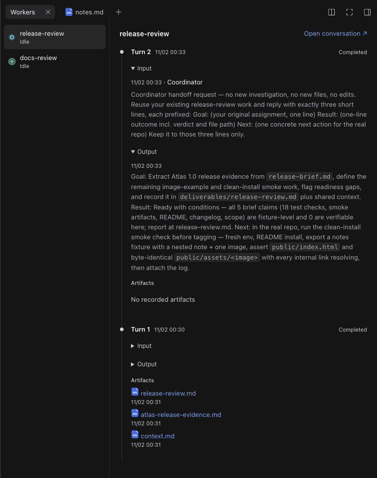
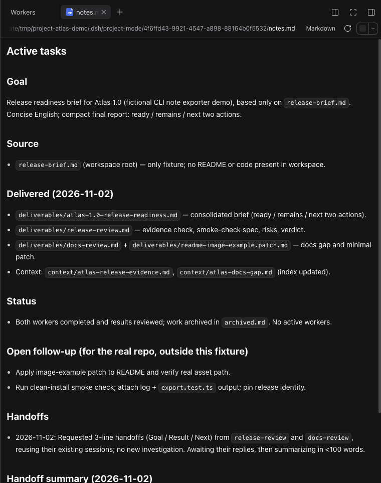

# MoA+ for DeepSeek Harness

**让多个 Agent 更好地协作。** MoA+ 是 DeepSeek Harness 的多 Agent 协作插件，由 Coordinator 组织持久化 Workers，共享上下文并审阅结果。

[English](README.md) | 简体中文

[](docs/media/project-workflow.mp4)

**一个项目，一支持续工作的团队。** 派发任务，随时进入 Worker，始终知道下一步。

[观看 60 秒协作演示](docs/media/project-workflow.mp4) · [查看界面效果](#实际效果) · [安装使用](#快速开始)

**非官方源码预览版，最新已发布标签为 v0.1.23。** 需要 DSH **0.2.1-rc.3 及本仓库列出的三个兼容扩展**，下方的独立环境脚本会准备好这些扩展；原版 rc.3 无法直接启用插件。详见[兼容说明](docs/compatibility.md)。

原 Project Mode。v0.1.23 运行时和演示仍使用 **Project** 标识，原有包名保持兼容。

## 目录

- [核心能力](#核心能力)
- [实际效果](#实际效果)
- [快速开始](#快速开始)
- [使用指南](#使用指南)
- [项目记忆](#项目记忆)
- [DSH 界面功能](#dsh-界面功能)
- [项目结构](#项目结构)
- [开发](#开发)
- [API 与文档](#api-与文档)
- [当前限制](#当前限制)
- [许可证](#许可证)

## 核心能力

你在主会话提出目标，Coordinator 判断创建新 Worker 还是沿用已有会话，提供必要上下文，选择引导当前工作还是排队处理，审阅结果并继续安排后续工作。每个 Worker 都有独立、持久化的会话，可以接续多轮任务；你也可以随时进入 Worker，直接补充指令。

| 能力               | 带来的帮助                                                                      |
| ------------------ | ------------------------------------------------------------------------------- |
| 持续协调           | 同一个 Coordinator 会话维护项目工作记录，判断下一步。                           |
| 完整的 Worker 控制 | 派生或复用 Worker、引导当前工作、排队下发后续指令、查看状态与历史、打断或删除。 |
| 共享项目知识       | Coordinator 与 Workers 共同维护索引，按需渐进加载上下文。                       |
| 自动返回结果       | Worker 每轮结束后自动返回完整的最终 AI 消息，交给 Coordinator 审阅。            |
| 用户直接参与       | 进入 Worker 直接引导工作，再返回 Coordinator 继续协调。                         |
| DSH 原生执行       | Session、Agent Loop、工具、权限、消息投递和 Stop 均由 DSH 承担。                |

## 实际效果

用一个小型 CLI 改动展示协作过程：Exporter 实现标题排序并补测试，Docs 维护使用说明，Coordinator 审阅两边的结果。用户进入 Exporter 会话更改排序要求，下一轮再沿用约定，加入一篇笔记。

[](docs/media/project-workflow.mp4)

这段剪辑展示真实的 CLI 任务：**派发 Workers → 人工进入 Exporter 改排序要求 → Coordinator 接回变化 → 下一轮复用已有 Workers 和共享上下文**。等待过程经过剪辑并全程标注，不代表任务在 60 秒内完成；最终示例通过了 9 项真实测试。可以[复现任务](docs/demo-workflow.md)，也可以[查看实际产物](docs/demo-result)。可以[打开 MP4](docs/media/project-workflow.mp4)控制播放，也可以[查看工作台原图](docs/media/project-workspace.png)。
[](docs/media/workflow-result.png)

### 看清每个 Worker 做了什么

选中 Worker，按由近到远的顺序查看每一轮工作。需要时展开原始指令和最终 AI 回复，打开记录的产物，或直接进入子会话引导它。

[](docs/media/worker-timeline.png)

### 下一次继续时，项目记录还在

`notes.md` 就在对话旁边，保留目标、已交付工作、当前状态和下一步。Coordinator 负责维护工作记录，可复用的知识则持续积累到共享上下文索引中。

[](docs/media/project-notes.png)

协作视频使用 v0.1.23 独立环境和公开的 Note Bundle 示例；较早的细节图来自 v0.1.22 的虚构项目 **Project Atlas**。这些均为真实 DSH 界面，不是概念图，也不作为速度基准。[素材来源与复用说明](docs/media/README.md)。

## 快速开始

当前源码预览版从 `main` 安装，推荐创建一个独立的**兼容 DSH Web 环境**。需要 Node **24.9+**、npm 和 Git：

```sh
git clone https://github.com/Burns1028/moa-plus.git
cd moa-plus
node scripts/moa.mjs setup
node scripts/moa.mjs start
```

Setup 会安装锁定版本的 rc.3 运行时，并且只在 `~/.dsh-project-mode/rc3` 内应用三个已审计的扩展。不复用日常 Desktop 应用、`~/.dsh`、全局 Agent 配置和工作区。原生 Web 界面在本地打开；配置模型后新建会话，在发送第一条消息前选择 **MoA**。

已有环境会被复用。测试修改后的源码时，即使插件版本号相同，也要为 setup 和 start 指定同一个全新空目录 `--dir`，具体命令见下方首次运行指南。

运行 `node scripts/moa.mjs doctor` 可以检查准备结果。[首次运行指南](docs/quickstart.md)说明了路径、重启和恢复方式，也可以直接尝试[可复现的项目任务](docs/demo-workflow.md)。

如果已有准备好的兼容 Desktop／运行时，仍可通过它的原生 CLI 安装插件：

```sh
dsh plugin --profile desktop add "git+https://github.com/Burns1028/moa-plus.git#v0.1.23"
```

固定版本 v0.1.23 仍使用旧 Project 标签和 `scripts/project-mode.mjs` 入口。原版 rc.3 仍不兼容。Setup 是显式运行的脚本，不是 npm 安装钩子，也不会修改已有的 Desktop 应用。[兼容说明](docs/compatibility.md)保留了三个原生扩展和手工准备方式；各版本安装包见 [Releases](https://github.com/Burns1028/moa-plus/releases)。

## 使用指南

| 角色        | 职责                                                                                                                         |
| ----------- | ---------------------------------------------------------------------------------------------------------------------------- |
| 用户        | 提出目标、作出决定、与 Coordinator 沟通，也可以进入 Worker 会话直接引导工作。                                                |
| Coordinator | 选择和引导 Workers、供给上下文、审阅结果、维护工作记录、整理共享知识并汇报进展。澄清、汇总和简单独立操作也可以由它自己完成。 |
| Worker      | 完成分配的调查或执行任务，补充可复用的发现，以一条自包含的最终 AI 消息返回结果。                                             |

常见流程：

1. 用户把目标交给 Coordinator。它查看 Workers 状态和相关项目记忆，了解用户对子会话的直接操作。
2. 它判断复用已有 Worker 还是派生新 Worker，下发目标和上下文，再更新 `notes.md`。
3. 工作发生变化时，用 **steer** 引导当前工作，用 **queue** 将指令留到当前 turn 结束后处理。打断和删除是另外的操作。
4. Worker 每轮结束自动返回最后一条完整 AI 消息。没有 AI 消息的轮次，也会通知 Worker 身份、轮次和结果状态，并返回空的 AI 结果。
5. Coordinator 审阅后继续下发或结束工作，更新工作记录和可复用上下文。正常情况下，相关工作和结果接收完成后，在同一个原生 Coordinator turn 内收口。

用户直接操作 Worker 后，再与 Coordinator 沟通时，它可以查看当前状态并按需回看对话。

## 项目记忆

```text
.dsh/project-mode/<project-id>/
├── notes.md                 待办、分工、进度、阻塞和下一步
├── archived.md              完成或告一段落的工作及其结果
└── context/
    ├── context.md           共享索引：文件路径和简短介绍
    ├── decisions.md         可复用的决定与依据，按需创建
    └── ...                  其他可复用的项目知识
```

`notes.md` 和 `archived.md` 由 Coordinator 维护，让它知道项目进行到了哪里、还有什么需要推进。

上下文由 Coordinator 和 Workers 共同维护。Agent 先读 `context/context.md`，再按当前任务需要读取具体文件。Workers 补充有价值、可复用的发现，并更新索引；Coordinator 更多负责整理、合并、删除过时或重复的内容。日常进度保留在工作记录中。

这些文件随项目持续积累，采用渐进式加载，不会在每次请求中全量展开。详细职责见 [MoA 模型](docs/moa-architecture.md)。

## DSH 界面功能

- 新建会话，在发送第一条消息前选择 **MoA**。首次 turn 启动后，该会话保持启用 MoA。
- 在原生工作区侧栏展开 Coordinator，打开其 Workers。每个 Worker 都有稳定的身份图标和当前状态。
- 点击主会话里的 Worker 胶囊进入子会话。胶囊保留在派发、更新或接收结果所对应的对话段，后续普通回复不会搬动旧胶囊。
- 右侧默认打开 **Workers** 和 **notes.md**。Workers 按由近到远的顺序展示每轮原始输入、最终 AI 输出和记录的产物；每条正文默认显示最多两行文字，超出部分显示省略号，点击正文展开完整 Markdown 或收起。两个 Tab 都允许关闭。
- Worker 输入框提供返回 Coordinator 的 **Back**，沿用原生派生权限，不提供独立权限选择器。归档主会话时，其管理的 Workers 一起归档。

原生派生和控制工具仅在 Coordinator 的 Agent 作用域中替换，Workers 与普通会话保留原生工具组合。Stop 保持可用，不会自动停止所有 Workers。

## 项目结构

```text
packages/moa/
├── src/host/       项目生命周期、Worker 操作和结果投递
├── src/client/     侧栏、胶囊和项目页签
├── src/shared/     共享类型与接口契约
└── lib/            插件构建产物
compat/rc3/         经审计的运行时兼容补丁
scripts/            构建、兼容和验证脚本
tests/              回归与原生接口测试
docs/               模型、架构、API 和验证文档
```

## 开发

需要 Node **24.9+**、npm 和 Git。

```sh
git clone https://github.com/Burns1028/moa-plus.git
cd moa-plus
npm ci
node scripts/apply-native-compat.mjs --dry-run
node scripts/apply-native-compat.mjs --backup "$PWD/.superpowers/native-backup"
npm test -- --maxWorkers=1
```

`npm test` 会先构建插件。修改 `packages/moa/src`，通过构建重新生成并提交 `lib` 产物。类型检查、原生接口测试、安装包验证和测试地图见[贡献指南](CONTRIBUTING.md)。

## API 与文档

Coordinator 通过 `control_workers` 使用 `spawn`、`list`、`get`、`send`、`history`、`interrupt` 和 `delete`。`send` 区分引导当前工作的 **steer** 与留待下一轮处理的 **queue**。参数、示例和结果语义见工具 API。

| 文档                                                                      | 内容                            |
| ------------------------------------------------------------------------- | ------------------------------- |
| [MoA 模型](docs/moa-architecture.md)                                      | 角色职责与渐进式共享上下文      |
| [代码架构](docs/architecture.md)                                          | 模块、函数、数据结构和执行路径  |
| [工具 API](docs/tool-api.md)                                              | Worker 控制、消息投递和历史窗口 |
| [兼容说明](docs/compatibility.md)                                         | rc.3 所需的显式运行时扩展       |
| [验证记录](docs/verification.md)／[手工验收](docs/manual-verification.md) | 已验证内容与真实应用检查方法    |

## 当前限制

分工仍由模型判断，预览版不保证每次都作出理想选择，也不使用任务关键词、命令次数或时间阈值强迫派发。

欢迎用一个小项目试用，并在 [试用反馈](https://github.com/Burns1028/moa-plus/issues/new?template=project-mode-trial.yml) 分享使用场景或安装反馈。如果希望持续关注项目，点一个 Star 也能帮助更多人发现它。

## 许可证

MIT。参见 [LICENSE](LICENSE) 和[第三方声明](THIRD_PARTY_NOTICES.md)。
